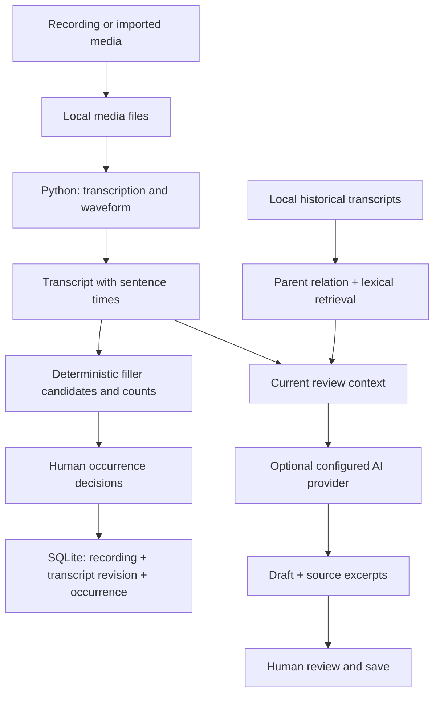

# Architecture

The standalone `/demo` page stops at browser-side discovery. It does not access the material library or a model.

## Decisions

1. Counting is deterministic; contextual judgements remain suggestions until confirmed.
2. Occurrence keys combine word and character offset. Transcript revisions isolate stale decisions.
3. Retrieval excludes the current record and later records, prioritizes the parent and earlier siblings, and returns at most four bounded excerpts.
4. Historical excerpts remain distinguishable from the current transcript and from model instructions.
5. A retrieved excerpt cannot prove a whole-recording improvement. The model is instructed to qualify such comparisons.

## Limits

Lexical retrieval misses paraphrases. Chinese segmentation and heuristic candidate generation can produce false positives. ASR can omit fillers or corrupt timing. The project does not infer personality or make medical judgements. Online generation depends on provider availability and credit; local discovery and storage do not.
